# UTSOB (উৎসব) — Multi-Phase Development Roadmap

> **Document Version:** 1.0.0  
> **Status:** APPROVED (Phase 01)  
> **Scope:** Phase 01 through Phase 10 Master Execution Plan  

---

## 1. Roadmap Overview

Utsob follows a disciplined, phased execution strategy. Each phase has strict entry and exit criteria. Features must not be built ahead of their designated phase to ensure foundational stability, security, and architectural integrity.

```mermaid
flowchart LR
    P1["Phase 01\nFoundation & Arch\n[CURRENT]"] --> P2["Phase 02\nAuth & User Domain"]
    P2 --> P3["Phase 03\nTemplates & Bangla Fonts"]
    P3 --> P4["Phase 04\nVisual Card Editor"]
    P4 --> P5["Phase 05\nGemini Bangla AI"]
    P5 --> P6["Phase 06\nSharing & Export Engine"]
    P6 --> P7["Phase 07\nInvitations & RSVP"]
    P7 --> P8["Phase 08\nMonetization & bKash"]
    P8 --> P9["Phase 09\nCreator Marketplace"]
    P9 --> P10["Phase 10\nHardening & Launch"]
```

---

## 2. Phase Breakdown

### Phase 01: Foundation & System Architecture (Current Phase)
- **Objective**: Establish the technical blueprint, strict developer toolchain, database schema, security boundaries, and core project scaffold.
- **Key Deliverables**:
  - Comprehensive architectural documentation suite (10 documents).
  - Clean Next.js 15+ App Router scaffold with strict TypeScript, Tailwind CSS, ESLint.
  - Normalized Prisma schema covering all 12 core domain entities.
  - Strict Zod environment variable validation (`env.ts`).
  - Structured logging and standardized error handling subsystem.
  - Bengali localization foundation (numeral converters and font manifests).
  - Initial unit test harness (Vitest) passing with 100% green status.
- **Dependencies**: None.
- **Gate Check**: PO approval of Phase 01 completion report.

---

### Phase 02: Core Data Models, Authentication & User Management
- **Objective**: Implement robust user identity, session management, and profile workflows.
- **Key Deliverables**:
  - Auth.js (v5) implementation with Google OAuth and Email/Password credentials.
  - PostgreSQL session adapter and token verification.
  - User profile management (name, phone, avatar, language preference).
  - Protected route middleware and server-side session utilities.
  - Automated integration tests for authentication lifecycle.
- **Dependencies**: Phase 01.

---

### Phase 03: Template Catalog, Categorization & Bengali Typography Engine
- **Objective**: Deliver high-performance template discovery and font rendering subsystem.
- **Key Deliverables**:
  - Category hierarchy (Pohela Boishakh, Eid, Wedding, Birthday, National Days).
  - Template catalog browsing with search, filtering, and tag classification.
  - Bengali typography engine: dynamic loading and caching for approved typefaces (Hind Siliguri, Noto Serif Bengali, Anek Bangla, Tiro Bangla, Galada).
  - Responsive template card previews with dynamic OG tags.
- **Dependencies**: Phase 02.

---

### Phase 04: Visual Card Editor Core (Fabric.js Integration)
- **Objective**: Build the interactive, web-based 2D visual editor.
- **Key Deliverables**:
  - Fabric.js canvas wrapper with responsive viewport scaling.
  - Multi-layer management (stacking, reordering, locking, visibility).
  - Rich text editing with real-time Bengali font switching, alignment, letter spacing, and line height.
  - Image and sticker placement, transformation controls (rotate, scale, crop).
  - Undo/redo state history management.
  - Auto-saving canvas state to PostgreSQL `JSONB` via debounced API calls.
- **Dependencies**: Phase 03.

---

### Phase 05: Bengali AI Copywriting & Wish Generator (Gemini API)
- **Objective**: Integrate culturally intelligent AI to assist users in writing heartfelt Bengali messages.
- **Key Deliverables**:
  - Google Gemini API client integration with safety filtering.
  - Prompt engineering tailored for Bangladeshi celebrations, tones (formal, poetic, humorous, affectionate), and relationships (parents, friends, colleagues).
  - Bengali rhyming poetry and couplet generation.
  - One-click copy and auto-injection into the active Fabric.js canvas text layer.
  - Rate limiting and token usage accounting in `AIGeneration` table.
- **Dependencies**: Phase 04.

---

### Phase 06: Sharing Engine, Public Viewing & High-Res Export
- **Objective**: Enable smooth social sharing and print/digital card exports.
- **Key Deliverables**:
  - Cryptographically secure public share link generation (`/c/[slug]`).
  - Public card viewer optimized for mobile social feeds (WhatsApp, Facebook, Messenger).
  - Server-side dynamic OpenGraph image generator using `@vercel/og`.
  - Client-side and serverless high-resolution raster export (PNG/WebP, 300 DPI print quality) and PDF export.
  - Share link analytics (view counter, access timestamp).
- **Dependencies**: Phase 04.

---

### Phase 07: Digital Invitations & RSVP Lifecycle Management
- **Objective**: Provide event management capabilities for weddings, parties, and corporate galas.
- **Key Deliverables**:
  - Invitation entity management linked to greeting cards.
  - Public RSVP submission interface (guest name, phone number, guest count, dietary preferences).
  - Host dashboard with live RSVP attendee list, accept/decline breakdown, and CSV export.
  - SMS / WhatsApp RSVP confirmation notification integration.
- **Dependencies**: Phase 06.

---

### Phase 08: Monetization, Premium Assets & Bangladeshi Payment Gateways
- **Objective**: Monetize premium templates, designer stickers, and commercial invitation packages.
- **Key Deliverables**:
  - Template tiering (Free vs Premium).
  - Payment gateway integration for Bangladesh: **bKash**, **Nagad**, and **SSLCommerz**.
  - Webhook processing for instant payment reconciliation and asset unlock.
  - Purchase invoices and transaction history.
- **Dependencies**: Phase 07.

---

### Phase 09: Creator Marketplace & Community Templates
- **Objective**: Allow Bangladeshi designers and artists to publish card templates and earn revenue.
- **Key Deliverables**:
  - Creator onboarding and portfolio submission workflow.
  - Template submission and admin review/moderation pipeline.
  - Revenue sharing and royalty calculation ledger.
  - Creator public profile pages and template attribution.
- **Dependencies**: Phase 08.

---

### Phase 10: Performance Optimization, Production Hardening & Security Audit
- **Objective**: Finalize system reliability, load tolerance, and compliance ahead of general availability.
- **Key Deliverables**:
  - Load testing targeting 50,000 concurrent greeting card shares during peak festivals.
  - Full OWASP security audit and penetration testing.
  - SEO optimization and Google Core Web Vitals tuning.
  - Comprehensive Playwright end-to-end regression test suite.
  - Public production launch on custom domain (`utsob.app` / `utsob.com.bd`).
- **Dependencies**: Phase 09.

