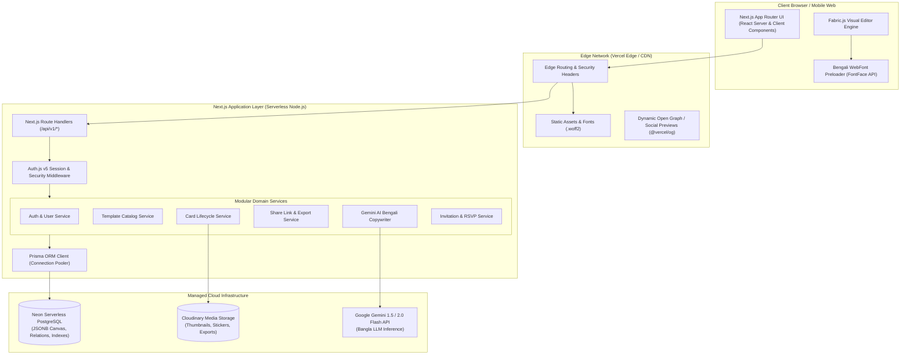

# UTSOB (উৎসব) — System Architecture

> **Document Version:** 1.0.0  
> **Status:** APPROVED (Phase 01)  
> **Author:** Senior Software Architect, Principal Full-Stack Engineer  
> **Target Platform:** Next.js App Router (Modular Monolith) on Vercel + Neon PostgreSQL  

---

## 1. Executive Summary & Product Vision

**Utsob (উৎসব — Celebrate Every Moment)** is Bangladesh's dedicated, Bengali-first digital celebration platform. It empowers Bangladeshi individuals, families, and organizations to design, customize, download, and share culturally resonant Bengali greeting cards and digital invitations.

### Core Product Pillars
1. **Bengali Greeting Card Creation**: Native Bengali greeting templates for Pohela Boishakh, Eid-ul-Fitr, Eid-ul-Adha, Durga Puja, weddings (বিয়ে / গায়ে হলুদ), birthdays (শুভ জন্মদিন), anniversaries, and national celebrations.
2. **Customizable Visual Card Editor**: Interactive 2D canvas editor powered by Fabric.js with multi-layer layout, sticker/graphic placement, and rich Bengali typographic controls.
3. **Bengali Typography & Font Engine**: Native conjunct (যুক্তবর্ণ) preservation, preloaded Google and custom Bengali web fonts, and automated font metrics resolution for HTML5 Canvas rendering.
4. **AI-Powered Bengali Wishes & Poetry**: Cultural-contextual generation of celebratory greetings, rhyming poetry, and formal invitation messages using Google Gemini API.
5. **Digital Invitations with RSVP Lifecycle**: Interactive invitations with real-time RSVP management, attendee count tracking, dietary notes, and event reminders.
6. **Public Sharing & Distribution**: High-performance public sharing via unique, tamper-proof share tokens, social preview cards (Open Graph / WhatsApp / Facebook), and high-resolution raster/PDF export.
7. **Premium Templates & Monetization**: Tiered template catalog with premium designer collections, asset licensing, and local Bangladeshi payment gateway integration (bKash, Nagad, SSLCommerz).
8. **Creator Marketplace (Future)**: Ecosystem for Bangladeshi artists, typographers, and graphic designers to publish templates and earn royalties.

---

## 2. High-Level System Architecture

Utsob adopts a **Modular Monolith** architecture deployed onto **Vercel** with a serverless **Neon PostgreSQL** database. Route Handlers within Next.js App Router serve as the unified API layer, avoiding the operational overhead and cold-start cascading of decoupled microservices.

---

## 3. Component Responsibilities

### 3.1 Client Presentation Layer
- **Framework**: Next.js 15+ (App Router) with React 19.
- **Styling**: Tailwind CSS with CSS Variables for theming (supporting both light and dark cultural palettes).
- **Component Primitives**: `shadcn/ui` (accessible Radix UI primitives wrapped in customized Tailwind styling).
- **State Management**: React Context / Zustand for lightweight local editor state; React Server Components for data fetching.

### 3.2 Visual Card Editor Engine (Future Phase 04 Core)
- **Engine**: Fabric.js (HTML5 Canvas 2D object model).
- **Canvas State**: Serialized to structured JSON conforming to Utsob's Canvas Document Specification, stored in PostgreSQL `JSONB`.
- **Bengali Typography Subsystem**: WebFont loading coordination via browser `FontFace` API. Ensures fonts are fully parsed into memory before canvas text metrics calculation, preventing glyph displacement or fallback rendering during export.

### 3.3 API Transport Layer
- **Protocol**: RESTful JSON over HTTPS via Next.js Route Handlers (`src/app/api/v1/*`).
- **Validation**: Strict boundary validation on query parameters, path arguments, and request bodies using Zod schemas.
- **Envelope Standardization**: Uniform response format (`{ success: true, data: ... }` / `{ success: false, error: ... }`).

### 3.4 Modular Domain Services Layer
- Located under `src/features/{domain}/services/`.
- Encapsulates pure business logic (e.g., card ownership verification, canvas sanitization, template cloning, share link expiration).
- Zero cross-domain spaghetti imports; inter-domain calls occur through clean public service interfaces.

### 3.5 Data Access Layer
- **ORM**: Prisma ORM with strongly-typed model generation.
- **Engine**: PostgreSQL hosted on **Neon**.
- **Connection Strategy**: Pooled connections via Neon PgBouncer (`DATABASE_URL`) for serverless functions, with direct URL (`DIRECT_URL`) reserved for migrations.
- **Canvas Storage**: Canvas documents are stored as native `JSONB`, allowing indexable metadata queries while preserving dynamic multi-layered design trees.

### 3.6 External Integrations
- **Cloudinary**: Authenticated image upload, transformation, background removal for user assets, and hosting rendered card output.
- **Google Gemini API**: Generative Bengali text completions for poems, greeting wishes, and event descriptions with temperature tuning for cultural tone.
- **Vercel**: Edge-distributed hosting, preview deployments, environment variable isolation, and automated CI/CD.

---

## 4. Bengali-First Architecture Strategy

Building a Bengali-first platform introduces specific technical challenges that standard English-first platforms ignore:

| Challenge | Architectural Solution |
| :--- | :--- |
| **Complex Conjuncts (যুক্তবর্ণ)** | UTF-8 NFC normalization at database ingestion. Strict OpenType ligature engine support via modern WOFF2 fonts. |
| **Canvas Font Desynchronization** | Canvas rendering is gated behind `document.fonts.ready` and explicit `FontFace` loading promises. Font metrics are measured after loading. |
| **Bengali Numeral Formatting** | Dedicated bidirectional numeral converter (`0-9` ↔ `০-৯`) in `src/lib/bengali/numbers.ts` for dates, counters, prices, and page numbers. |
| **Cultural Color Palettes & Motifs** | Custom Tailwind semantic theme tokens representing traditional Bangladeshi colors (e.g., `alpona-red`, `boishakh-mustard`, `jamdani-green`, `festive-gold`). |
| **Search & Indexing** | PostgreSQL text search configuration accounting for Bengali Unicode character sequences and combining diacritics. |

---

## 5. Architectural Quality Attributes & Non-Functional Requirements

### 5.1 Performance
- **Target LCP**: < 1.8s for public card viewer pages.
- **Canvas Hydration**: Sub-300ms canvas initialization for greeting card templates on mobile devices.
- **Bundle Optimization**: Lazy-loading Fabric.js and heavy export modules so marketing and public view pages remain lightweight.

### 5.2 Security
- **Strict Server-Side Authorization**: Card ownership verified on every mutating request; `userId` is never trusted from client payloads.
- **Canvas JSON Sanitization**: Stored JSON is sanitized against executable script injection (SVG script tags, malicious `javascript:` image URIs).
- **Public Share Isolation**: Private card data (creator personal notes, draft histories) is never returned by public sharing endpoints.

### 5.3 Reliability & Scalability
- **Serverless Resilience**: Stateless API route handlers auto-scaling with festive spikes (e.g., millions of greetings shared on Eid and Pohela Boishakh mornings).
- **Database Elasticity**: Neon compute auto-scaling and connection pooling to prevent pool exhaustion during burst traffic.

