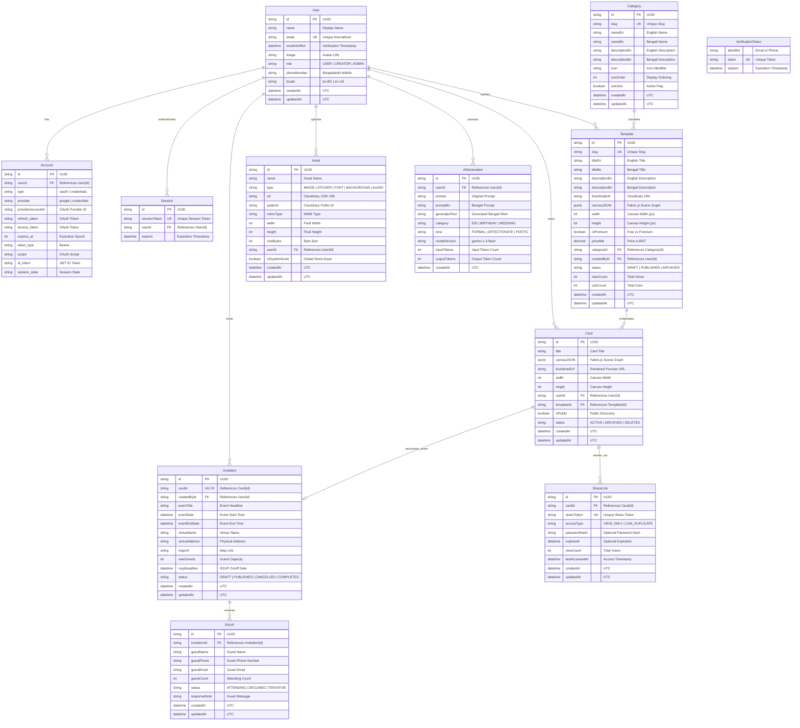

# UTSOB (উৎসব) — Entity Relationship Diagram (ERD)

> **Document Version:** 1.0.0  
> **Status:** APPROVED (Phase 01)  
> **Engine:** PostgreSQL (Neon)  

---

## 1. Visual Entity Relationship Diagram

---

## 2. Relational Integrity & Cascade Rules

| Relation | Parent Entity | Child Entity | Foreign Key | On Delete Rule | Business Justification |
| :--- | :--- | :--- | :--- | :--- | :--- |
| User ➔ Account | User | Account | `userId` | `CASCADE` | Removing a user account must remove all associated authentication identities. |
| User ➔ Session | User | Session | `userId` | `CASCADE` | Sessions must instantly terminate upon user deletion. |
| User ➔ Card | User | Card | `userId` | `CASCADE` | Deleting a user removes all their personal greeting cards. |
| Category ➔ Template | Category | Template | `categoryId` | `RESTRICT` | Cannot delete a category that has active templates assigned to it. |
| Template ➔ Card | Template | Card | `templateId` | `SET NULL` | Deleting a template does not delete customized user cards already created from it. |
| Card ➔ ShareLink | Card | ShareLink | `cardId` | `CASCADE` | Deleting a greeting card immediately destroys all public sharing tokens. |
| Card ➔ Invitation | Card | Invitation | `cardId` | `CASCADE` | An invitation cannot exist without its underlying digital card. |
| Invitation ➔ RSVP | Invitation | RSVP | `invitationId` | `CASCADE` | Deleting an invitation removes all associated guest responses. |

