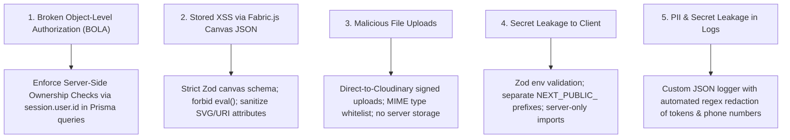

# UTSOB (উৎসব) — Security Architecture Specification

> **Document Version:** 1.0.0  
> **Status:** APPROVED (Phase 01)  
> **Classification:** Technical Security Standard  

---

## 1. Security Philosophy & Threat Model

Utsob handles personal celebrations, private family invitations, uploaded photographs, and payment-related events. The security architecture adheres to **Defense in Depth** and the **Principle of Least Privilege**.

### Critical Threat Vectors & Mitigations



---

## 2. Environment Variables & Secret Management

1. **Validation at Startup**:
   - Environment variables are parsed and validated using Zod in `src/lib/env.ts` during application initialization and build time.
   - Missing or malformed secrets immediately abort application boot with descriptive diagnostics.
2. **Client-Side Secret Isolation**:
   - Only variables explicitly prefixed with `NEXT_PUBLIC_` are bundled into the client bundle (e.g. `NEXT_PUBLIC_APP_URL`).
   - Server-only secrets (`DATABASE_URL`, `AUTH_SECRET`, `CLOUDINARY_API_SECRET`, `GEMINI_API_KEY`) are protected by the `server-only` package to trigger build-time failures if accidentally imported into client components.
3. **Repository Hygiene**:
   - `.env`, `.env.local`, `.env.production` are strictly tracked in `.gitignore`.
   - `.env.example` provides safe developer placeholders with zero production credentials.

---

## 3. Identity, Authentication & Authorization

### 3.1 Session Security
- Authentication is governed by **Auth.js (v5)** with database sessions stored in PostgreSQL.
- Session cookies use:
  - `HttpOnly: true` (Prevents JavaScript read access / XSS theft).
  - `Secure: true` in production (Transmitted exclusively over TLS).
  - `SameSite: "lax"` (Prevents Cross-Site Request Forgery).

### 3.2 Server-Side Authorization Boundary
- **Never trust client-submitted identifiers**: Endpoints modifying or accessing resources must **never** accept `userId` in the request body or query string.
- Every mutating database query must verify ownership via the session context:
  ```typescript
  // CORRECT: Scoped by authenticated user ID
  const card = await prisma.card.findFirst({
    where: {
      id: cardId,
      userId: session.user.id,
    },
  });
  if (!card) {
    throw new NotFoundError("Card not found or access denied");
  }
  ```

---

## 4. Canvas JSON & Editor Security

Fabric.js represents canvases as JSON scene graphs. Storing and rendering arbitrary user JSON presents critical stored XSS risks if malicious SVG tags (`<script>`) or javascript URIs (`javascript:alert(1)`) are embedded.

### Security Controls:
1. **No Code Execution**:
   - `eval()`, `new Function()`, or dynamic script execution is strictly prohibited across the codebase.
   - Fabric.js canvas state is deserialized strictly through `canvas.loadFromJSON()` after schema validation.
2. **Strict Zod Canvas Schema**:
   - Input canvas documents are validated against `canvasDocumentSchema`.
   - All object types must match a whitelist (`i-text`, `text`, `image`, `rect`, `circle`, `path`, `group`).
   - URL attributes on image objects are validated to ensure they use approved HTTPS protocols (Cloudinary domains or trusted CDNs). Data URIs containing SVG scripts are rejected.
3. **Public Share Sanitization**:
   - When serving cards via public share links (`/api/v1/share/[token]`), user identity fields, creator metadata, and internal status flags are completely stripped.

---

## 5. File Upload Security Strategy

User photographs, backgrounds, and custom assets must not compromise system stability.

1. **Direct Signed Uploads to Cloudinary**:
   - Files are never uploaded directly to Next.js serverless functions.
   - The client requests a temporary, cryptographically signed upload signature from `/api/v1/assets/sign-upload`.
   - The signature restricts:
     - Allowed MIME types: `image/png`, `image/jpeg`, `image/webp`.
     - Maximum file size: `10MB` for images, `5MB` for font assets.
     - Destination folder: `utsob/user_uploads/{userId}/`.
2. **SVG Sanitization**:
   - Any SVG stickers or motifs must be processed via DOMPurify / sanitize-svg to strip event listeners (`onload`, `onerror`) before storage.

---

## 6. Public Share Token Security

1. **High-Entropy Tokens**:
   - Share tokens are generated using cryptographically secure random generators (`crypto.randomUUID()` or `nanoid(21)`), giving > 120 bits of entropy.
   - Token guessing via brute force is mathematically infeasible.
2. **Optional Password Protection**:
   - Private family cards and wedding invitations can be protected by a passkey hashed with `bcrypt` (salt rounds ≥ 10).
3. **Revocation & Expiration**:
   - Users can revoke a share token or set an expiration timestamp (`expiresAt`). Once expired or deleted, the share link returns `404 Not Found`.

---

## 7. Rate Limiting & Abuse Prevention

1. **Tiered Rate Limiting Strategy**:
   - **Public Share Viewer**: 100 requests per IP per minute.
   - **AI Generation (`/api/v1/ai/generate`)**: 10 requests per user per minute (sliding window); total daily quota enforced per user tier.
   - **Authentication Endpoints**: 5 failed login attempts per IP per 15 minutes.
2. **Implementation**:
   - In-memory token bucket for development/testing; Upstash Redis / Vercel KV for production edge enforcement.

---

## 8. Structured Logging & PII Scrubbing

1. **Format**: All logs are emitted as structured JSON objects with UTC timestamps, log levels (`INFO`, `WARN`, `ERROR`), and correlation IDs.
2. **PII Masking Filter**:
   - The logger (`src/lib/logger.ts`) automatically scrubs sensitive patterns before console or remote ingestion:
     - Authorization headers (`Bearer ***`).
     - Passwords and secret keys (`password`, `secret`, `token`).
     - Bangladeshi phone numbers (`+8801...` redacted to `+8801*****XX`).
     - Email addresses (`user@domain.com` redacted to `u***@domain.com`).
3. **Safe Error Responses**:
   - In production (`NODE_ENV === 'production'`), internal database errors and stack traces are suppressed and logged internally with a correlation ID, while the client receives a safe generic message (`"An unexpected error occurred. Reference ID: <id>"`).
