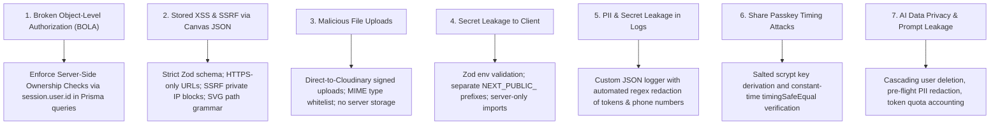

# UTSOB (উৎসব) — Security Architecture Specification

> **Document Version:** 1.1.0 (Audited & Remediated)  
> **Status:** APPROVED  
> **Classification:** Technical Security Standard  

---

## 1. Security Philosophy & Threat Model

Utsob handles personal celebrations, private family invitations, uploaded photographs, and payment-related events. The security architecture adheres to **Defense in Depth** and the **Principle of Least Privilege**.

### Critical Threat Vectors & Mitigations



---

## 2. Environment Variables & Secret Management

1. **Validation at Startup**:
   - Environment variables are parsed and validated using Zod in `src/lib/env.ts` during application initialization and build time.
   - Missing or malformed secrets immediately abort application boot with descriptive diagnostics.
2. **Client-Side Secret Isolation**:
   - Only variables explicitly prefixed with `NEXT_PUBLIC_` are bundled into the client bundle (e.g. `NEXT_PUBLIC_APP_URL`).
   - Server-only secrets (`DATABASE_URL`, `AUTH_SECRET`, `CLOUDINARY_API_SECRET`, `GEMINI_API_KEY`) are protected to prevent accidental client bundling.
3. **Repository Hygiene**:
   - `.env`, `.env.local`, `.env.production` are strictly tracked in `.gitignore`.
   - `.env.example` provides safe developer placeholders with zero production credentials.

---

## 3. Identity, Authentication & Authorization Architecture

### 3.1 Auth.js Official Constraint & Strategy
- **Official Specification Constraint**: In Auth.js (v5), the Credentials Provider (`credentials`) fundamentally requires stateless JWT sessions (`strategy: "jwt"`). It **cannot** create or maintain sessions in the database via the Prisma Adapter (`strategy: "database"`).
- **Approved MVP Architecture**:
  - **Provider**: Standardized strictly on **Google OAuth (OIDC)** for the MVP.
  - **Adapter**: `@auth/prisma-adapter` connecting to Neon PostgreSQL.
  - **Session Strategy**: Strictly **Database Sessions (`strategy: "database"`)**.
  - **Revocation**: Active sessions exist as real rows in the `Session` table, enabling instantaneous server-side session revocation when required.
  - **No Credentials Provider in MVP**: Email/password credentials are omitted in the initial MVP to prevent session incompatibility and avoid password storage/credential stuffing risks.

### 3.2 Session Security
- Session cookies use:
  - `HttpOnly: true` (Prevents JavaScript read access / XSS theft).
  - `Secure: true` in production (Transmitted exclusively over TLS).
  - `SameSite: "lax"` (Prevents Cross-Site Request Forgery).

### 3.3 Server-Side Authorization Boundary
- **Never trust client-submitted identifiers**: Endpoints modifying or accessing resources must **never** accept `userId` in the request body or query string.
- Every mutating database query must verify ownership via the session context:
  ```typescript
  // CORRECT: Scoped by authenticated user ID
  const card = await prisma.card.findFirst({
    where: {
      id: cardId,
      userId: session.user.id,
    },
  });
  if (!card) {
    throw new NotFoundError("Card not found or access denied");
  }
  ```

---

## 4. Canvas JSON & Editor Security

Fabric.js represents canvases as JSON scene graphs. Storing and rendering arbitrary user JSON presents critical stored XSS, SSRF, prototype pollution, and denial-of-service risks.

### Security Controls Implemented in `card.schema.ts`:
1. **Strict Object Allowlist & Schema Strictness**:
   - Only approved Fabric.js types are permitted: `i-text`, `text`, `textbox`, `image`, `rect`, `circle`, `line`, `path`, `group`.
   - Every object schema utilizes `.strict()` to reject unknown attributes, blocking prototype pollution (`__proto__`, `constructor`, `prototype`).
2. **SSRF & Scheme Restriction**:
   - All image URLs (`src`) must strictly use the `https:` protocol.
   - Plain `http:`, `data:`, `file:`, `blob:`, and `javascript:` URIs are rejected.
   - Private and internal IP ranges are actively blocked:
     - `localhost`, `127.0.0.1`, `0.0.0.0`, `::1`
     - Cloud metadata endpoints: `169.254.169.254`
     - Private networks: `10.0.0.0/8`, `172.16.0.0/12`, `192.168.0.0/16`
3. **SVG Path Grammar Validation**:
   - Fabric `path` objects must match strict SVG path coordinate syntax (`/^[MmLlHhVvCcSsQqTtAaZz0-9\s,.-+]+$/`).
   - Any XML, HTML, `<script>`, or event handlers embedded in path strings trigger validation failure.
4. **CSS Expression & Color Sanitization**:
   - Color properties (`fill`, `stroke`, `backgroundColor`) forbid `url()`, `expression()`, `<` and `>`.
5. **Denial of Service (DoS) & Recursion Protections**:
   - Maximum 200 objects per canvas document (`MAX_CANVAS_OBJECTS = 200`).
   - Maximum 50 child objects per group.
   - **No nested groups**: Group objects are restricted to leaf objects (`canvasGroupChildSchema`), completely eliminating recursive group bombs.
   - Text length is capped at 2,000 characters per text object.
6. **No Execution of Canvas Code**:
   - `eval()` and `new Function()` are prohibited across the codebase.
   - Canvas JSON is deserialized strictly through `canvas.loadFromJSON()` after Zod validation.

---

## 5. File Upload Security Strategy

User photographs, backgrounds, and custom assets must not compromise system stability.

1. **Direct Signed Uploads to Cloudinary**:
   - Files are never uploaded directly to Next.js serverless functions.
   - The client requests a temporary, cryptographically signed upload signature from `/api/v1/assets/sign-upload`.
   - The signature restricts:
     - Allowed MIME types: `image/png`, `image/jpeg`, `image/webp`.
     - Maximum file size: `10MB` for images, `5MB` for font assets.
     - Destination folder: `utsob/user_uploads/{userId}/`.
2. **SVG Sanitization**:
   - Any SVG stickers or motifs must be processed to strip event listeners (`onload`, `onerror`) before storage.

---

## 6. Public Share Token & Passkey Security

Implemented in `src/lib/security/crypto.ts`:
1. **High-Entropy Tokens**:
   - Share tokens are generated using `crypto.randomBytes(16).toString("base64url")`, providing 128 bits of cryptographic entropy.
   - Token guessing via brute force is computationally impossible ($2^{128}$ combinations).
2. **Passkey Hashing**:
   - Private cards protected with a passkey are hashed using Node.js native `crypto.scryptSync` with a cryptographically random 16-byte salt (`N=16384, r=8, p=1, keylen=64`).
   - Passkeys are never stored in plaintext.
3. **Constant-Time Verification**:
   - Passkey verification uses `crypto.timingSafeEqual` between derived key buffers, eliminating timing side-channel attacks.
4. **Revocation & Expiration**:
   - `isShareLinkExpired()` helper evaluates `expiresAt`. Once expired or deleted, public access immediately terminates with 404.

---

## 7. Rate Limiting & Abuse Prevention

1. **Tiered Rate Limiting Strategy**:
   - **Public Share Viewer**: 100 requests per IP per minute.
   - **AI Generation (`/api/v1/ai/generate`)**: 10 requests per user per minute (sliding window); total daily quota enforced per user tier.
   - **Authentication Endpoints**: 5 failed login attempts per IP per 15 minutes.
2. **Implementation**:
   - In-memory token bucket for development/testing; Upstash Redis / Vercel KV for production edge enforcement.

---

## 8. Structured Logging & PII Scrubbing

1. **Format**: All logs are emitted as structured JSON objects with UTC timestamps, log levels (`INFO`, `WARN`, `ERROR`), and correlation IDs.
2. **PII Masking Filter**:
   - The logger (`src/lib/logger.ts`) automatically scrubs sensitive patterns before console or remote ingestion:
     - Authorization headers (`Bearer ***`).
     - Passwords and secret keys (`password`, `secret`, `token`).
     - Bangladeshi phone numbers (`+8801...` redacted to `+88017XX-XXXX5678`).
     - Email addresses (`user@domain.com` redacted to `u***@domain.com`).
3. **Safe Error Responses**:
   - In production (`NODE_ENV === 'production'`), internal database errors and stack traces are suppressed and logged internally with a correlation ID, while the client receives a safe generic message (`"An unexpected error occurred. Reference ID: <id>"`).

---

## 9. AI Privacy & Data Governance (AIGeneration)

1. **Prompt Retention & User Deletion Rights**:
   - Historical prompts and AI-generated outputs are stored in `AIGeneration` linked to `userId`.
   - The foreign key relationship specifies `onDelete: Cascade`. When a user requests account deletion, all their historical prompts and outputs are completely and irrevocably purged.
   - Recommended 90-day retention pruning policy for stored prompt text.
2. **Pre-Flight PII Redaction**:
   - Before submitting user prompts to the Google Gemini API, client-side or server-side text must pass through PII filtering to strip phone numbers and emails.
3. **API Key Isolation**:
   - `GEMINI_API_KEY` is strictly managed via `src/lib/env.ts` as a server-side environment secret without `NEXT_PUBLIC_` exposure.
4. **Usage Accounting**:
   - `inputTokens` and `outputTokens` are logged to audit quota consumption and prevent billing abuse.
