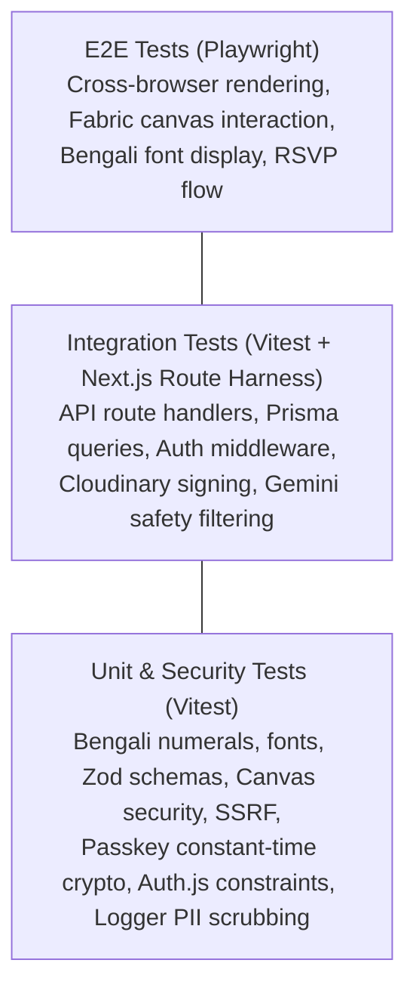

# UTSOB (উৎসব) — Testing Strategy Specification

> **Document Version:** 1.1.0 (Audited & Remediated)  
> **Status:** APPROVED  
> **Testing Frameworks:** Vitest (Unit/Integration) & Playwright (E2E)  

---

## 1. Testing Philosophy & Pyramid

Utsob enforces a comprehensive, automated quality assurance strategy. Given our Bengali-first visual card engine, testing must verify both pure business/data logic and real browser typographic canvas rendering.

| Layer | Tooling | Target Execution Time | Frequency |
| :--- | :--- | :--- | :--- |
| **Unit & Security Tests** | Vitest | < 2 seconds | Every file save / pre-commit hook |
| **Integration Tests** | Vitest + Test DB | < 15 seconds | Every Git push / Pull Request |
| **E2E Tests** | Playwright (Chromium/WebKit) | < 2 minutes | Nightly / Pre-deployment pipeline |

---

## 2. Unit & Security Testing Strategy (Vitest)

Unit tests focus on deterministic pure functions, domain utilities, Zod validation schemas, localization algorithms, and cryptographic security primitives.

### 2.1 Key Test Suites (Phase 01 & 01.1 Scope)
1. **Bengali Numeral Converter (`tests/unit/bengali/numbers.test.ts`)**:
   - Converts English integers and floats (`12345`) to Bengali numerals (`১২৩৪৫`).
   - Converts Bengali numerals (`১২৩৪৫`) back to English numbers (`12345`).
   - Handles negative numbers, decimals, currency formatting (`৳`), and invalid inputs.
2. **Bengali Typography Manifests (`tests/unit/bengali/typography.test.ts`)**:
   - Verifies font configurations for Hind Siliguri, Noto Serif Bengali, Anek Bangla, Tiro Bangla, Galada.
   - Verifies font weight definitions, fallbacks, and CSS variable exports.
3. **Environment Schema (`tests/unit/env.test.ts`)**:
   - Validates that missing required variables (e.g. `DATABASE_URL`) throw descriptive validation errors.
   - Validates that valid variables parse cleanly with type coercion (e.g. `PORT`).
4. **Error Envelope & Hierarchy (`tests/unit/errors.test.ts`)**:
   - Verifies custom error classes (`NotFoundError`, `ValidationError`, `UnauthorizedError`, `ForbiddenError`).
   - Verifies standard error envelope generation matches API conventions.
5. **Structured Logger & PII Redaction (`tests/unit/logger.test.ts`)**:
   - Verifies log formatting in JSON.
   - Verifies automated masking of phone numbers (`+88017XX-XXXX5678`), emails, bearer tokens, and passwords.
6. **Multi-Vector Hardened Canvas Schema (`tests/unit/canvas.test.ts`)**:
   - Verifies acceptance of valid Fabric.js canvas scene graphs.
   - Verifies rejection of dangerous protocols (`javascript:`, unencrypted `http:`, executable `data:` URIs).
   - Verifies SSRF protection against private IP addresses (localhost, 127.0.0.1, 169.254.169.254, RFC 1918).
   - Verifies rejection of CSS expressions and `<script>` in colors.
   - Verifies SVG path grammar validation.
   - Verifies DoS caps: max 200 objects, rejection of nested groups.
7. **Cryptographic Security & Passkey Suite (`tests/unit/security/crypto.test.ts`)**:
   - Verifies 128-bit cryptographic entropy of `generateShareToken()`.
   - Verifies salted scrypt derivation for share passkeys.
   - Verifies constant-time comparison via `crypto.timingSafeEqual` (preventing timing attacks).
   - Verifies expiration detection logic (`isShareLinkExpired`).
8. **Auth.js Compatibility & Architecture Constraints (`tests/unit/auth/auth-compatibility.test.ts`)**:
   - Verifies database session strategy lock.
   - Verifies omission of Credentials Provider in MVP per Auth.js official constraints.
   - Verifies `@auth/prisma-adapter` schema requirements.

---

## 3. Integration Testing Strategy

Integration tests evaluate multi-component workflows, Route Handlers, and database persistence.

### 3.1 Test Database & Prisma Mocking
- Development integration tests utilize Neon development branch databases or an isolated PostgreSQL test instance.
- Unit-level integration harnesses use a strongly-typed Prisma Mock client to simulate database responses without network roundtrips.

### 3.2 External Service Mocking
- **Cloudinary**: Mocked using local dummy signed tokens; never invokes remote upload APIs in CI.
- **Google Gemini API**: Mocked responses returning static Bengali greeting poems and celebratory wishes.

---

## 4. End-to-End Testing Strategy (Playwright)

Playwright validates end-user interactions in real browser engines (Chromium, Firefox, WebKit).

### 4.1 Critical E2E Scenarios (Roadmap)
- **Visual Regression for Bengali Typography**: Renders greeting cards with complex Bengali conjuncts (e.g., "শুভ নববর্ষ", "আন্তর্জাতিক মাতৃভাষা দিবস", "কৃষ্ণচূড়া") and compares snapshot diffs across operating systems.
- **Canvas Interaction**: Simulates drag-and-drop of stickers, text editing, and font family switching.
- **High-Resolution Export**: Verifies that the exported PNG/WebP contains exact font glyphs without falling back to system sans-serif.
- **RSVP Form Submission**: Verifies mobile-first guest submission and real-time host attendee list update.

---

## 5. Coverage Goals & Quality Gates

| Metric | Target | Enforced At |
| :--- | :--- | :--- |
| **Unit Test Coverage** | ≥ 85% Statements & Branches | CI Pull Request Gate |
| **Security Test Coverage** | 100% Critical Attack Vectors | CI Pull Request Gate |
| **TypeScript Strictness** | Zero `any` types; `strict: true` | `npm run typecheck` |
| **Linting & Code Quality** | Zero warnings; ESLint flat config | `npm run lint` |
